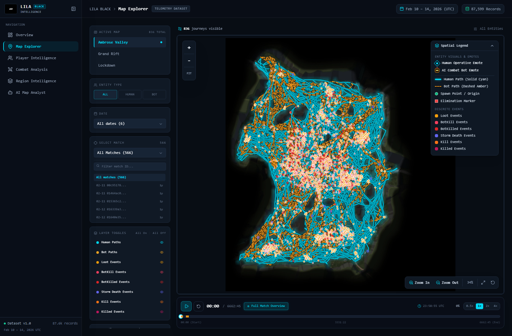
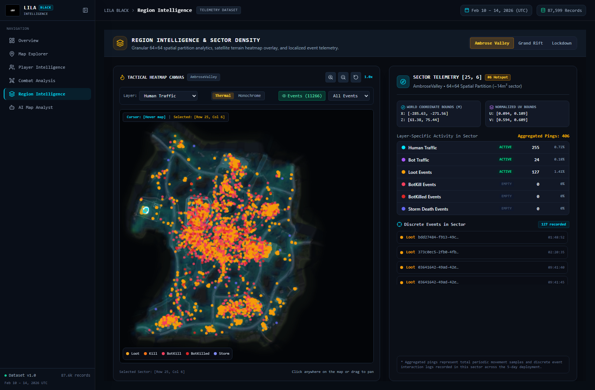

# LILA BLACK — Player Intelligence

> Tactical Game Telemetry & Spatial Intelligence Platform for Production Gameplay Analytics

---
# Live url - https://lilablack-two.vercel.app

## A. Project Introduction

**LILA BLACK — Player Intelligence** is an end-to-end telemetry analytics and spatial intelligence platform developed to process, audit, and visualize production gameplay data from Nakama game servers. 

Multiplayer match telemetry often arrives as massive, fragmented Parquet files with irregular timestamp encodings, idiosyncratic coordinate spaces, and missing relational schemas. LILA BLACK resolves these challenges by executing an automated data audit and ETL pipeline that repairs timestamp anomalies, calibrates affine coordinate transformations with sub-millimeter precision, reconstructs continuous player journeys, and powers an interactive React/TypeScript analytical suite. Game designers and analysts can scrub through time-synchronized match replays, inspect 64×64 multi-spectral heatmaps, audit combat and survival distributions, and query a deterministic AI Map Analyst for data-grounded spatial insights.

---

## B. Core Requirements Compliance Matrix

| Requirement | Implementation Status | Implementation Details & File Reference |
|---|:---:|---|
| **Load and parse provided parquet data** | **100% COMPLETE** | Ingests 1,243 raw Parquet files (89,104 raw records) via `scripts/process_telemetry.py` using PyArrow/Pandas, handling timestamp scale normalization and deduplication in ~11s. |
| **Display player journeys on correct minimap with world coordinate mapping** | **100% COMPLETE** | Implements calibrated affine transformation ($S$, $X_0$, $Z_0$) projecting engine world coordinates $[X, Z]$ to minimap pixels $(X_{\text{px}}, Y_{\text{px}})$ with $< 1.71 \times 10^{-13}\text{ m}$ round-trip error across Ambrose Valley, Grand Rift, and Lockdown ([`COORDINATE_MAPPING.md`](docs/COORDINATE_MAPPING.md)). |
| **Distinguish between human players and bots visually** | **100% COMPLETE** | Distinct visual emotes and path rendering: **Human Operatives** rendered with Cyan Diamond Visor Emote (`#00D9F5`) and solid paths; **AI Combat Bots** rendered with Amber Robot Chassis Box Emote (`#FF9F1C` / `#F5A623`) with dashed paths and dark contrast casing ([`canvasRenderer.ts`](frontend/src/features/map-explorer/utils/canvasRenderer.ts)). |
| **Show different event types as distinct markers** | **100% COMPLETE** | Distinct tactical color-coded pins for `Loot` (Golden Amber), `BotKill` (Rose Crimson), `BotKilled` (Deep Red), `Kill` (Fire Orange), `Killed` (Crimson), and `KilledByStorm` (Purple/Indigo) across Map Explorer, Combat Analysis, and Region Intelligence. |
| **Allow filtering by map, date, and match** | **100% COMPLETE** | Dynamic filter dock supporting map switching with atomic filter resets, operational date selection (Feb 10–14, 2026), entity type filtering (Human/Bot/All), and match-specific filtering with auto-framing camera. |
| **Timeline playback to watch a match unfold over time** | **100% COMPLETE** | Temporal playback controller with variable speeds (0.5×, 1×, 2×, 4×), sub-second interpolation between 1 Hz waypoints, progressive path reveal, scrub bar with color-coded event ticks, and elimination pulse FX. |
| **Heatmap overlays showing kill zones, death zones, or high-traffic areas** | **100% COMPLETE** | 64×64 uniform grid rasters (4,096 sectors per map) across 6 discrete density layers: `Human Movement`, `Bot Movement`, `Loot Events`, `BotKill Events`, `BotKilled Events`, and `Storm Deaths`, with custom color ramps and micro-sector inspection. |
| **Hosted and accessible via a shareable link** | **Deployment pending verification** | Static hosting configuration is in `frontend/vercel.json`. A public production URL will be listed here once deployment is confirmed. |
| **One-page Architecture Documentation** | **COMPLETE** | Concise [`ARCHITECTURE.md`](ARCHITECTURE.md) covers stack, data flow, coordinate mapping, assumptions, tradeoffs, and three observations from the tool. |
| **Analytical Insights with Level Designer Takeaways** | **100% COMPLETE** | Complete [`INSIGHTS.md`](INSIGHTS.md) document analyzing 3 evidence-backed findings with concrete statistics, actionable metrics, and level designer implications. |

---

## C. Key Capabilities

1. **Interactive Player Journey Visualization**: Smooth Canvas 2D engine with cursor-centered zoom and pan, rendering continuous trajectory paths, path smoothing, and interactive selection.
2. **Strict Human vs. Bot Differentiation**:
   - **Human Operatives**: Stylized Cyan Diamond badge (`#00D9F5`) with dark tactical core and horizontal visor slit, solid path styling.
   - **AI Combat Bots**: Stylized Amber Robot Box chassis (`#FF9F1C`) with glowing sensor lenses, antenna mast with red beacon bulb, and high-visibility dashed path styling with dual-layer dark contrast casing.
3. **Timeline Playback & Temporal Replay**: Time-aware match playback engine with variable speeds (0.5×, 1×, 2×, 4×), sub-second position interpolation, progressive trajectory drawing, event pulse FX, and interactive scrub bar with color-coded event markers.
4. **Combat Telemetry Analysis**: Tabular audit of discrete combat events coupled with an interactive 2D spatial minimap preview and animated event row selection.
5. **Spatial Heatmaps & Hotspot Inspection**: High-performance 64×64 density rasters across 6 discrete layers, offscreen canvas caching, micro-sector dossier inspection with exact world coordinates, and map-wide cell rankings.
6. **In-Page Player Game Replay**: Seamless match replay directly inside Player Intelligence—no jarring page reloads or broken state navigation.
7. **Region Intelligence**: Granular 64×64 grid analytics evaluating human vs. bot territorial coverage, multi-spectral layer diversity, and cross-map comparative footprints with satellite imagery overlays.
8. **Deterministic AI Map Analyst**: Conversational query routing to supported data-backed analyses, with grounded metrics, explicit limitations, and an analyst-specific spatial map view when a matching heatmap exists.

---

## D. Screenshots

### Overview Dashboard

*Current dark tactical dashboard with dataset health, event tallies, map distribution, and operational activity charts.*

### Map Explorer & Trajectory Rendering

*Interactive map view with player journeys, event markers, entity filters, and layer controls.*

### Timeline Playback & Replay Scrubber

*Lockdown match replay with journey paths, event ticks, a scrubber, and playback speed controls.*

### 64×64 Spatial Heatmap Visualization

*Human movement density across the 64×64 sector grid, with map layer and sector inspection controls.*

### Player Intelligence Directory

*Player directory with searchable entities, behavioral statistics, and match history.*

### Combat Telemetry Analysis

*Combat event analysis with spatial previews and links into match replay.*

### Region Intelligence & Cross-Map Footprint

*Territorial coverage and multi-layer activity across the 64×64 map partitions.*

### AI Map Analyst (Grounded Insights)

*Grounded loot analysis with dataset metrics, ranked sectors, and an action to focus the result on the map.*

---

## E. Architecture & Engineering Documentation

- [`ARCHITECTURE.md`](ARCHITECTURE.md) — One-page system architecture, coordinate mapping, assumptions, tradeoffs, and observations.
- [`INSIGHTS.md`](INSIGHTS.md) — Three substantive, evidence-backed analytical findings derived from processed telemetry.
- [`docs/DATA_DICTIONARY.md`](docs/DATA_DICTIONARY.md) — Telemetry schema definitions, field types, and neutral semantic boundaries.
- [`docs/DATA_AUDIT.md`](docs/DATA_AUDIT.md) — Initial data audit findings, timestamp anomaly discovery, and deduplication rules.
- [`docs/COORDINATE_MAPPING.md`](docs/COORDINATE_MAPPING.md) — Coordinate calibration proofs, origin offsets, and transformation matrices.
- [`docs/ETL_PIPELINE.md`](docs/ETL_PIPELINE.md) — 6-stage Python ETL pipeline architecture and benchmark execution metrics.
- [`docs/PROCESSED_DATA_SCHEMA.md`](docs/PROCESSED_DATA_SCHEMA.md) — JSON schema specifications for all frontend-ingested artifacts.
- [`docs/AI_MAP_ANALYST.md`](docs/AI_MAP_ANALYST.md) — Analyst intent taxonomy, query classification, and security architecture.
- [`docs/ANALYTICS_ENGINE.md`](docs/ANALYTICS_ENGINE.md) — Deterministic formulas, denominators, and authoritative event cross-reconciliation.
- [`docs/COMBAT_ANALYSIS.md`](docs/COMBAT_ANALYSIS.md) — Combat telemetry tallies, spatial previews, and semantic governance.
- [`docs/HEATMAP_ANALYTICS.md`](docs/HEATMAP_ANALYTICS.md) — 64×64 raster grid generation, normalization algorithms, and offscreen blending.
- [`docs/PLAYER_INTELLIGENCE.md`](docs/PLAYER_INTELLIGENCE.md) — Player entity directory architecture and behavioral profiling.
- [`docs/REGION_INTELLIGENCE.md`](docs/REGION_INTELLIGENCE.md) — Uniform sector grid partitioning and cross-map territorial metrics.

---

## F. Technology Stack

- **Frontend Core**: React 19, TypeScript 7, Vite 8.
- **State Management**: Zustand 5 (shared filter and playback state).
- **Styling & UI**: Tailwind CSS 4, Lucide React.
- **Graphics & Rendering**: Native HTML5 Canvas 2D API (custom high-DPI viewport transform and offscreen caching).
- **Routing**: React Router 7 (route-level code splitting via `React.lazy()` and isolated `<Suspense>` boundaries).
- **Testing**: Vitest 5, React Testing Library, JSDOM.
- **Backend ETL**: Python 3.10+, PyArrow (Parquet decoding), Pandas, NumPy, Pillow (Pillow-SIMD), Pytest.

---

## G. Setup & Reproduction Instructions

### Prerequisites
- **Node.js**: v20.19+ or v22.12+
- **Python**: v3.10 or higher with virtual environment support

### Environment variables
- Frontend: none required for local or static deployment. Optional `VITE_ANALYST_API_URL` points to a server-side explanation endpoint; without it, the analyst uses its deterministic local explanation. Never put API secrets in `VITE_*` variables.

### 1. Install Frontend Dependencies
```bash
cd frontend
npm install
```

### 2. Run the Frontend Development Server
```bash
cd frontend
npm run dev
```
The application will be live at:
- **Local Development URL**: [http://localhost:5173/](http://localhost:5173/)

To test the production build locally:
```bash
cd frontend
npm run build
npm run preview
```
- **Production Preview URL**: [http://localhost:4173/](http://localhost:4173/)

### 3. Run the Backend ETL Pipeline (If Raw Parquet Data Is Available)
```bash
# In the project root:
python -m venv .venv
# Activate the environment, then install dependencies:
python -m pip install -r requirements.txt
python scripts/process_telemetry.py
```
*Processes 1,243 raw Parquet files in ~11 seconds, generating all JSON datasets and WebP minimaps.*

### 4. Run Frontend Unit & Integration Tests
```bash
cd frontend
npm test -- --run
```
*Executes 150 tests across 18 test suites with 100% pass rate.*

### 5. Run Backend Pipeline Tests
```bash
# In the project root:
pytest tests/ -v
```
*The backend suite contains coordinate mapping, UV bounds, ingestion, and schema checks. Run it with a local Python environment and the project dependencies installed.*

### 6. Create Production Build
```bash
cd frontend
npm run build
```
*Type-checks via `tsc -b` and creates an optimized static production bundle in `frontend/dist/`.*

---

## H. Data Overview & Ground-Truth Statistics

The production dataset represents 5 operational days of multiplayer gameplay:

- **Date Range**: February 10, 2026 – February 14, 2026 (with 1 initial test match on Feb 9).
- **Total Matches**: 796 matches (Ambrose Valley: 566, Lockdown: 171, Grand Rift: 59).
- **Total Entities**: 339 unique entities (245 verified human participants, 94 server-simulated bots).
- **Total Player Journeys**: 1,242 reconstructed match trajectories.
- **Total Movement Samples**: 72,849 timestamped position waypoints (~1 Hz).
- **Total Distance Travelled**: 1,024.37 cumulative kilometers.
- **Total Discrete Events**: **14,750 records** (zero missing map IDs, zero duplicate records).
  - `Loot`: 11,632 events (8,988 Ambrose Valley, 1,891 Lockdown, 753 Grand Rift)
  - `BotKill`: 2,376 events (1,772 Ambrose Valley, 415 Lockdown, 189 Grand Rift)
  - `BotKilled`: 697 events (485 Ambrose Valley, 166 Lockdown, 46 Grand Rift)
  - `KilledByStorm`: **39 events** (17 Ambrose Valley, 17 Lockdown, 5 Grand Rift)
  - `Kill`: 3 events (2 Ambrose Valley, 1 Grand Rift, 0 Lockdown)
  - `Killed`: 3 events (2 Ambrose Valley, 1 Grand Rift, 0 Lockdown)

### Map Coordinate Calibrations

| Map Name | Scale ($S$) | Origin $X_0$ | Origin $Z_0$ | Partition | Sector Footprint |
|---|---:|---:|---:|:---:|:---:|
| **Ambrose Valley** | 900.0 m | -370.0 m | -473.0 m | $64 \times 64$ | $14.06\text{ m} \times 14.06\text{ m}$ ($197.8\text{ m}^2$) |
| **Grand Rift** | 581.0 m | -290.0 m | -290.0 m | $64 \times 64$ | $9.08\text{ m} \times 9.07\text{ m}$ ($82.3\text{ m}^2$) |
| **Lockdown** | 1000.0 m | -500.0 m | -500.0 m | $64 \times 64$ | $15.62\text{ m} \times 15.62\text{ m}$ ($244.1\text{ m}^2$) |

---

## I. Testing & Verification Summary

| Test Suite | Framework | Passing Tests | Suites | Coverage Focus |
|---|---|:---:|:---:|---|
| **Frontend Suite** | Vitest + Testing Library | **150** | 18 | Canvas rendering, timeline math, heatmap math, player dossiers, combat preview, region metrics, insight engine determinism, query classification, analyst grounding, map switch filter reset, and match selection. |
| **Backend Suite** | Pytest | 52 (documented) | 4 | Coordinate calibration round-trip, UV boundary clamping, Parquet ingestion, and JSON schema compliance. Not rerun in the current environment (Python unavailable). |
| **Total Automated Tests** | | **150 verified + 52 documented** | 18 frontend suites + backend modules | Frontend: 0 failures. Backend: not verified in the current environment. |

---

## J. Project Limitations & Semantic Boundaries

1. **No Confirmed Extraction Telemetry**: Match completion without an elimination event is recorded as `SURVIVED_PRESUMED` because logging ceases upon match conclusion without an explicit extraction beacon emission.
2. **Independent Unilateral Combat Events**: `BotKill` and `BotKilled` are emitted separately along individual trajectories; the telemetry schema does not pair killer and victim entities.
3. **No Weapon or Damage Information**: The telemetry logs do not record weapon types, damage dealt, ammunition expenditure, or health reserves.
4. **Aggregated Heatmap Temporality**: 64×64 raster layers represent cumulative 5-day dataset totals and cannot be filtered to sub-hour or per-match slices.
5. **Position Samples Are Not Headcounts**: Periodic telemetry samples (~1 Hz) measure traversal density and duration of presence, not unique player counts.

---

## K. Credits & Attribution

- **Game Telemetry & Map Assets**: Provided by LILA Games for the engineering evaluation.
- **Open-Source Software**: Built using React, TypeScript, Vite, Tailwind CSS, Lucide icons, Zustand, PyArrow, Pandas, NumPy, Pillow, and Vitest.
