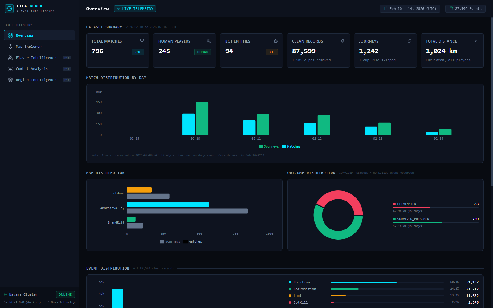
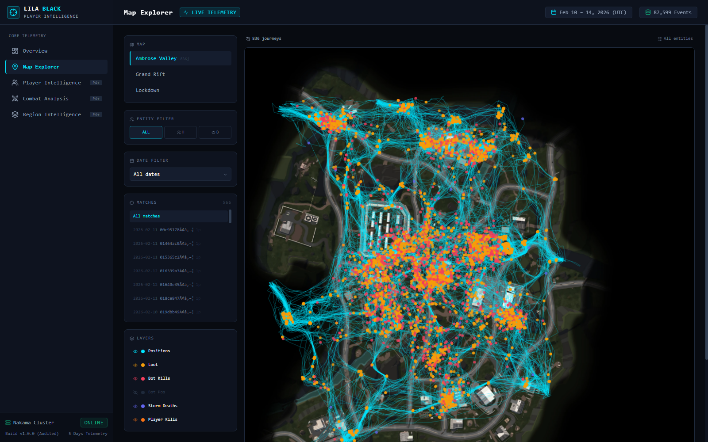
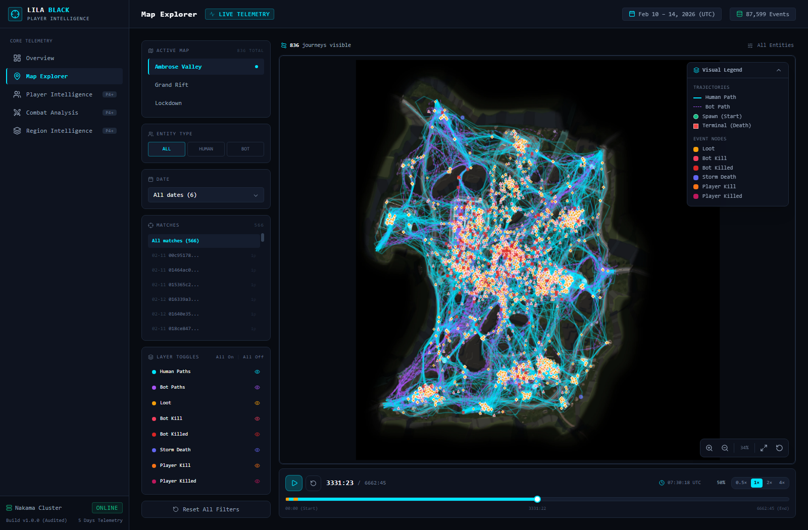
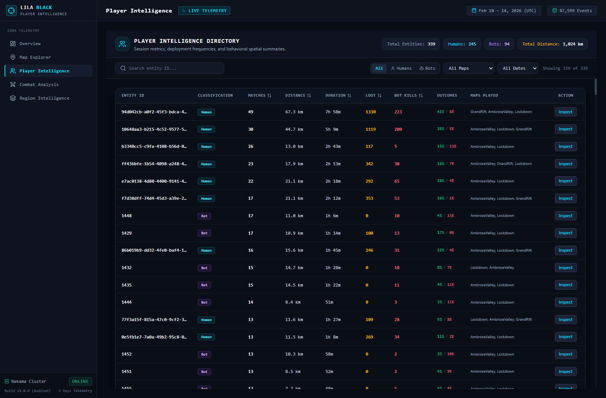
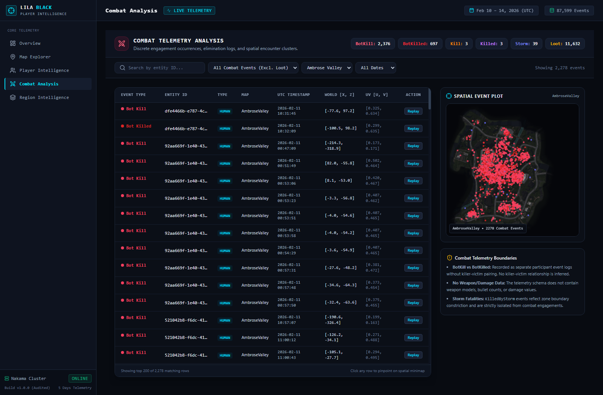
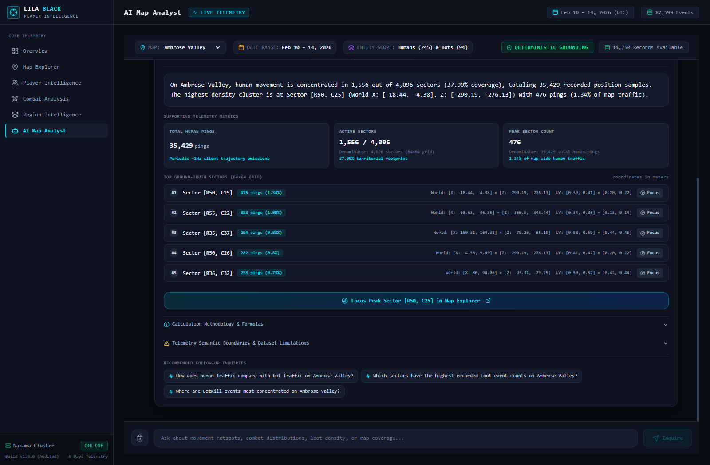

# LILA BLACK — Player Intelligence

> Tactical Game Telemetry & Spatial Intelligence Platform for Production Gameplay Analytics

---

## A. Project Introduction

**LILA BLACK — Player Intelligence** is an end-to-end telemetry analytics and spatial intelligence platform developed to process, audit, and visualize production gameplay data from Nakama game servers. 

Multiplayer match telemetry often arrives as massive, fragmented Parquet files with irregular timestamp encodings, idiosyncratic coordinate spaces, and missing relational schemas. LILA BLACK resolves these challenges by executing an automated data audit and ETL pipeline that repairs timestamp anomalies, calibrates affine coordinate transformations with sub-millimeter precision, reconstructs continuous player journeys, and powers an interactive React/TypeScript analytical suite. Game designers and analysts can scrub through time-synchronized match replays, inspect 64×64 multi-spectral heatmaps, audit combat and survival distributions, and query a deterministic AI Map Analyst for data-grounded spatial insights.

---

## B. Key Capabilities

1. **Interactive Player Journey Visualization**: Smooth Canvas 2D engine with cursor-centered zoom and pan, rendering continuous trajectory paths, path smoothing, and interactive selection.
2. **Human and Bot Trajectory Differentiation**: Clear visual demarcation of human participants (cyan `#00E5FF`) versus server-simulated bots (amber `#F59E0B`), supported by multi-parameter entity filters.
3. **Timeline Playback & Temporal Replay**: Time-aware match playback engine with variable speeds (0.5×, 1×, 2×, 4×), sub-second position interpolation, progressive trajectory drawing, event pulse FX, and interactive scrub bar with color-coded event markers.
4. **Combat Telemetry Analysis**: Tabular audit of discrete combat events (`BotKill`, `BotKilled`, `Kill`, `Killed`, `KilledByStorm`, `Loot`) coupled with an interactive 2D spatial minimap preview and direct replay deep-linking.
5. **Spatial Heatmaps & Hotspot Inspection**: High-performance 64×64 density rasters across 6 discrete layers, offscreen canvas caching, micro-sector dossier inspection with exact world coordinates, and map-wide cell rankings.
6. **Player Intelligence**: Searchable and sortable directory of 339 tracked entities (245 humans, 94 bots) detailing matches played, total distance, session duration, event counts, and outcome distributions.
7. **Region Intelligence**: Granular 64×64 grid analytics evaluating human vs. bot territorial coverage, multi-spectral layer diversity, and cross-map comparative footprints.
8. **Deterministic AI Map Analyst**: Conversational intelligence assistant querying 10 deterministic insight routines with strictly grounded metrics, exact formulas, immutable conclusions, and contextual Map Explorer navigation.

---

## C. Screenshots

### Overview Dashboard

*Dataset health, global event tallies, territorial coverage comparisons, and quick-action navigation.*

### Map Explorer & Trajectory Rendering

*High-performance Canvas 2D renderer displaying continuous player match journeys on Ambrose Valley.*

### Timeline Playback & Replay Scrubber

*Time-synchronized replay with sub-second interpolation, event ticks, and playback speed controls.*

### 64×64 Spatial Heatmap Visualization

*Thermal density raster visualizing human movement intensity across 4,096 sectors with sector dossier.*

### Player Intelligence Directory

*Searchable entity explorer detailing behavioral statistics, lifetime distance, and match histories.*

### Combat Telemetry Analysis

*Tabular log of discrete combat events with interactive spatial minimap pin preview and replay deep-linking.*

### Region Intelligence & Cross-Map Footprint

*Territorial coverage and multi-layer activity breakdown across the 64×64 map partitions.*

### AI Map Analyst (Grounded Insights)

*Natural language query response with deterministic metrics, top ground-truth sectors, and deep-link actions.*

---

## D. Architecture & Engineering Documentation

- [`ARCHITECTURE.md`](ARCHITECTURE.md) — One-page comprehensive system architecture specification and pipeline diagram.
- [`INSIGHTS.md`](INSIGHTS.md) — Three substantive, evidence-backed analytical findings derived from processed telemetry.
- [`docs/DATA_DICTIONARY.md`](docs/DATA_DICTIONARY.md) — Telemetry schema definitions, field types, and neutral semantic boundaries.
- [`docs/DATA_AUDIT.md`](docs/DATA_AUDIT.md) — Initial data audit findings, timestamp anomaly discovery, and deduplication rules.
- [`docs/COORDINATE_MAPPING.md`](docs/COORDINATE_MAPPING.md) — Coordinate calibration proofs, origin offsets, and transformation matrices.
- [`docs/ETL_PIPELINE.md`](docs/ETL_PIPELINE.md) — 6-stage Python ETL pipeline architecture and benchmark execution metrics.
- [`docs/PROCESSED_DATA_SCHEMA.md`](docs/PROCESSED_DATA_SCHEMA.md) — JSON schema specifications for all frontend-ingested artifacts.
- [`docs/AI_MAP_ANALYST.md`](docs/AI_MAP_ANALYST.md) — Analyst intent taxonomy, query classification, and security architecture.
- [`docs/ANALYTICS_ENGINE.md`](docs/ANALYTICS_ENGINE.md) — Deterministic formulas, denominators, and authoritative event cross-reconciliation.
- [`docs/COMBAT_ANALYSIS.md`](docs/COMBAT_ANALYSIS.md) — Combat telemetry tallies, spatial previews, and semantic governance.
- [`docs/HEATMAP_ANALYTICS.md`](docs/HEATMAP_ANALYTICS.md) — 64×64 raster grid generation, normalization algorithms, and offscreen blending.
- [`docs/PLAYER_INTELLIGENCE.md`](docs/PLAYER_INTELLIGENCE.md) — Player entity directory architecture and behavioral profiling.
- [`docs/REGION_INTELLIGENCE.md`](docs/REGION_INTELLIGENCE.md) — Uniform sector grid partitioning and cross-map territorial metrics.

---

## E. Technology Stack

- **Frontend Core**: React 18, TypeScript 5, Vite 5.
- **State Management**: Zustand 5 (synchronized multi-layer caching, filter states, and playback clocks).
- **Styling & UI**: Tailwind CSS 3, Lucide React (tactical dark theme design system).
- **Graphics & Rendering**: Native HTML5 Canvas 2D API (custom high-DPI viewport transform and offscreen caching).
- **Routing**: React Router 7 (route-level code splitting via `React.lazy()` and isolated `<Suspense>` boundaries).
- **Testing**: Vitest 1.4, React Testing Library, JSDOM.
- **Backend ETL**: Python 3.10+, PyArrow (Parquet decoding), Pandas, NumPy, Pillow (Pillow-SIMD), Pytest.

---

## F. Setup & Reproduction Instructions

### Prerequisites
- **Node.js**: v18.0.0 or higher
- **Python**: v3.10 or higher with virtual environment support

### 1. Install Frontend Dependencies
```bash
cd frontend
npm install
```

### 2. Run the Frontend Development Server
```bash
cd frontend
npm run dev
```
The application will be live at:
- **Local Development URL**: [http://localhost:5173/](http://localhost:5173/)

To test the production build locally:
```bash
cd frontend
npm run build
npm run preview
```
- **Production Preview URL**: [http://localhost:4173/](http://localhost:4173/)

### 3. Run the Backend ETL Pipeline (If Raw Parquet Data Is Available)
```bash
# In the project root:
python scripts/process_telemetry.py
```
*Processes 1,243 raw Parquet files in ~11 seconds, generating all JSON datasets and WebP minimaps.*

### 4. Run Frontend Unit & Integration Tests
```bash
cd frontend
npm test -- --run
```
*Executes 127 tests across 16 test suites with 100% pass rate.*

### 5. Run Backend Pipeline Tests
```bash
# In the project root:
pytest tests/ -v
```
*Executes 52 tests covering coordinate mappings, UV bounds, and schema conformity.*

### 6. Create Production Build
```bash
cd frontend
npm run build
```
*Type-checks via `tsc -b` and creates an optimized static production bundle in `frontend/dist/`.*

---

## G. Data Overview

The production dataset represents 5 operational days of multiplayer gameplay:

- **Date Range**: February 10, 2026 – February 14, 2026 (with 1 initial test match on Feb 9).
- **Total Matches**: 796 matches (Ambrose Valley: 566, Lockdown: 171, Grand Rift: 59).
- **Total Entities**: 339 unique entities (245 verified human participants, 94 server-simulated bots).
- **Total Player Journeys**: 1,242 reconstructed match trajectories.
- **Total Movement Samples**: 72,849 timestamped position waypoints (~1 Hz).
- **Total Distance Travelled**: 1,024.37 cumulative kilometers.
- **Total Discrete Events**: **14,750 records** (zero missing map IDs, zero duplicate records).
  - `Loot`: 11,632 events (8,988 Ambrose Valley, 1,891 Lockdown, 753 Grand Rift)
  - `BotKill`: 2,376 events (1,772 Ambrose Valley, 415 Lockdown, 189 Grand Rift)
  - `BotKilled`: 697 events (485 Ambrose Valley, 166 Lockdown, 46 Grand Rift)
  - `KilledByStorm`: **39 events** (17 Ambrose Valley, 17 Lockdown, 5 Grand Rift)
  - `Kill`: 3 events (2 Ambrose Valley, 1 Grand Rift, 0 Lockdown)
  - `Killed`: 3 events (2 Ambrose Valley, 1 Grand Rift, 0 Lockdown)

### Map Coordinate Calibrations

| Map Name | Scale ($S$) | Origin $X_0$ | Origin $Z_0$ | Partition | Sector Footprint |
|---|---:|---:|---:|:---:|:---:|
| **Ambrose Valley** | 900.0 m | −370.0 m | −473.0 m | $64 \times 64$ | $14.06\text{ m} \times 14.06\text{ m}$ ($197.8\text{ m}^2$) |
| **Grand Rift** | 581.0 m | −290.0 m | −290.0 m | $64 \times 64$ | $9.08\text{ m} \times 9.07\text{ m}$ ($82.3\text{ m}^2$) |
| **Lockdown** | 1000.0 m | −500.0 m | −500.0 m | $64 \times 64$ | $15.62\text{ m} \times 15.62\text{ m}$ ($244.1\text{ m}^2$) |

---

## H. Testing & Verification Summary

| Test Suite | Framework | Passing Tests | Suites | Coverage Focus |
|---|---|:---:|:---:|---|
| **Frontend Suite** | Vitest + Testing Library | **127** | 16 | Canvas rendering, timeline math, heatmap math, player dossiers, combat preview, region metrics, insight engine determinism, query classification, analyst grounding, and LLM fallback paths. |
| **Backend Suite** | Pytest | **52** | 4 | Coordinate calibration round-trip, UV boundary clamping, Parquet ingestion, and JSON schema compliance. |
| **Total Automated Tests** | | **179** | 18 test files/modules | **0 failing tests** |

---

## I. Project Limitations & Semantic Boundaries

1. **No Confirmed Extraction Telemetry**: Match completion without an elimination event is recorded as `SURVIVED_PRESUMED` because logging ceases upon match conclusion without an explicit extraction beacon emission.
2. **Independent Unilateral Combat Events**: `BotKill` and `BotKilled` are emitted separately along individual trajectories; the telemetry schema does not pair killer and victim entities.
3. **No Weapon or Damage Information**: The telemetry logs do not record weapon types, damage dealt, ammunition expenditure, or health reserves.
4. **Aggregated Heatmap Temporality**: 64×64 raster layers represent cumulative 5-day dataset totals and cannot be filtered to sub-hour or per-match slices.
5. **Position Samples Are Not Headcounts**: Periodic telemetry samples (~1 Hz) measure traversal density and duration of presence, not unique player counts.

---

## J. Credits & Attribution

- **Game Telemetry & Map Assets**: Provided by LILA Games for the engineering evaluation.
- **Open-Source Software**: Built using React, TypeScript, Vite, Tailwind CSS, Lucide icons, Zustand, PyArrow, Pandas, NumPy, Pillow, and Vitest.
