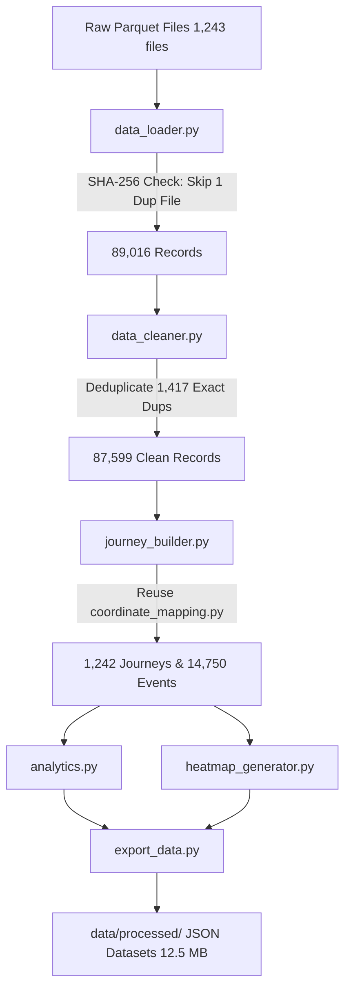

# LILA BLACK — Production Telemetry Data Processing Pipeline
**Project:** LILA BLACK — Player Intelligence  
**Phase:** Phase 2 — Production Telemetry Data Processing Pipeline  
**Status:** Validated & Deployed  
**Entry Point:** `scripts/process_telemetry.py`  
**Test Suite:** `tests/test_etl_pipeline.py` (52 total unit tests passing)  
**Author:** Senior Data Engineer  

---

## 1. Overview & Architecture

The Phase 2 ETL pipeline processes raw Apache Parquet telemetry from 1,243 files (suffixed `.nakama-0`) across 5 days of production gameplay. It cleans, normalizes, reconstructs player journeys, computes cross-session analytics, generates spatial heatmap density grids, and exports optimized JSON datasets under `data/processed/` for frontend consumption.

### Pipeline Component Diagram



### Script Architecture & Responsibilities

| Script | Responsibility | Primary Inputs & Outputs |
| :--- | :--- | :--- |
| `scripts/data_loader.py` | Scans directory, hashes files via SHA-256, discards duplicate files, ingests Parquet tables, extracts raw integer `ts`, decodes binary event bytes to UTF-8, and appends ISO-8601 UTC timestamps. | **In:** `data/raw/player_data/*/*.nakama-0`<br>**Out:** Ingested DataFrame (89,016 rows), Loader Report |
| `scripts/data_cleaner.py` | Deduplicates exact duplicate records while preserving legitimate same-timestamp tick collisions (movement + discrete action). Performs chronological sorting. | **In:** Ingested DataFrame<br>**Out:** Clean DataFrame (87,599 rows), Cleaning Report |
| `scripts/journey_builder.py` | Groups clean records by `(match_id, user_id)`. Reconstructs continuous position paths, extracts discrete event markers, projects coordinates to UV space via `coordinate_mapping`, computes path distance, and derives player outcome. | **In:** Clean DataFrame<br>**Out:** 1,242 Journey objects, Reconstruction Report |
| `scripts/analytics.py` | Computes global stats, match-level aggregations, player performance summaries, map metadata, and compiles the discrete events index. | **In:** Journeys List<br>**Out:** Global stats, Matches list, Players list, Maps metadata, Events list |
| `scripts/heatmap_generator.py` | Aggregates normalized UV coordinates into 64x64 spatial density grids per map across 6 isolated layers (human traffic, bot traffic, loot, bot kills, bot deaths, storm deaths). | **In:** Journeys List<br>**Out:** Map heatmaps dictionary |
| `scripts/export_data.py` | Serializes all data structures into compact, partitioned JSON files under `data/processed/`, computing directory manifest with sizes. | **In:** All analytics & journey objects<br>**Out:** 15 JSON files (12.51 MB total) |
| `scripts/process_telemetry.py` | Pipeline orchestrator providing single-command execution, execution timing, logging, and error tracking. | **CLI Entry Point** |

---

## 2. Execution & Reproducibility

The pipeline is completely deterministic and idempotent. It can be run with a single command:

```powershell
python scripts/process_telemetry.py
```

### Performance Characteristics
- **Total Runtime:** ~11.5 seconds on modern multi-core workstation.
- **Memory Footprint:** < 150 MB peak RAM.
- **Output Size:** 12.51 MB across 15 JSON files (highly compressed, compact JSON without redundant keys).

---

## 3. Data Cleaning & Transformation Rules

1. **Timestamp Normalization:**
   - The declared Parquet Arrow type `timestamp[ms]` is ignored.
   - Raw 64-bit integer values (~$1,770,750,000$) are extracted and treated as **Unix epoch seconds**.
   - Converted to numeric `ts_sec` (for mathematical sorting and duration calculations) and `ts_iso` (`YYYY-MM-DDTHH:MM:SSZ`) for human-readable display.
2. **File-Level Deduplication:**
   - Every file's SHA-256 hash is verified before reading.
   - `February_11/cfa03e9f..._ac049b28...nakama-0` was identified as an exact byte clone of `February_10/cfa03e9f..._ac049b28...nakama-0` and skipped (88 duplicate rows removed).
3. **Record-Level Deduplication:**
   - Exact duplicate rows (identical across `user_id, match_id, map_id, x, y, z, ts, event`) are identified and dropped.
   - 1,417 exact duplicate rows removed from accepted files (largely duplicate loot interactions during crate opening).
4. **Preservation of Same-Tick Event Collisions:**
   - When a player moves and performs an action (e.g. `Position` and `Loot`, or `Position` and `BotKilled`) on the exact same millisecond/second, both records are intentionally preserved.
   - 4,967 same-tick collisions preserved.
5. **Entity Classification:**
   - Checked strictly by `user_id.isdigit()`:
     - `user_id.isdigit() == True` -> `bot`
     - `user_id.isdigit() == False` -> `human` (UUID v4)
   - Do not rely on event names: bots 1429, 1402, and 1379 emitted standard `Position` and `Loot` events, but are correctly classified as bots.
6. **Outcome Derivation:**
   - If journey ends with `BotKilled`, `KilledByStorm`, or `Killed` -> `ELIMINATED`.
   - If journey ends with `Position`, `Loot`, or `BotKill` -> `SURVIVED_PRESUMED`.
   - No player is labeled as confirmed extracted due to lack of extraction telemetry.
